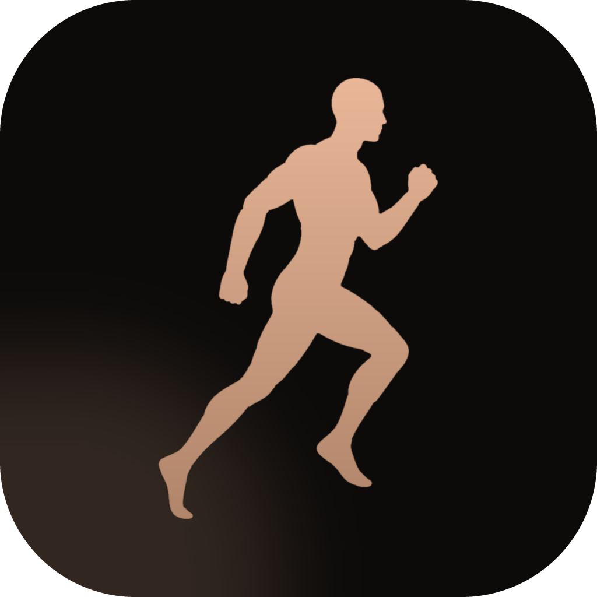

<div align="center">
  
  <h1>Scorpus</h1>
  <p><strong>Personal Offline-First Fitness, Running &amp; Gym Tracker for Android</strong></p>

  <p>
    
    
    
    
    
  </p>
</div>

---

## Overview

**Scorpus** (`com.dalvero.scorpus`) is a fast, privacy-focused personal fitness, running, and gym tracker built with Flutter and native Android Kotlin. Designed to work **100% offline** with zero subscriptions, zero ads, and full local data ownership.

## Key Features

- **Live & Manual Workout Logger** — Track `Weight × Reps`, `Reps Only`, `Time` (with isometric hold timer), and `Cardio` (distance & duration) with set types (`Warmup`, `Drop`, `Failure`, `Rest-Pause`), `RPE`/`RIR`, supersets, pocket-lock, and automatic progressive overload suggestions.
- **552+ Exercise Library & Routines** — Built-in vector exercise illustrations, custom exercises with photo/video media, multi-gym equipment & plate profiles (`Places`), weekly schedules, 8 program templates, and offline AI routine import.
- **Progress Analytics & Muscle Recovery** — 30-day volume trends, consistency heatmap, estimated 1RM charts, Personal Records (PR), muscle heatmaps (`7d` / `30d`), and exponential-decay muscle recovery visualization.
- **Body Tracking & Training Journal** — Bodyweight tracking, 10 body measurements, multi-pose progress photo timeline with side-by-side comparison, Moments gallery, and categorized training notes with media attachments.
- **Fitness Calculators & Shareable Cards** — 6 built-in calculators (1RM, BMI, TDEE/Macros, Body Fat, Plate Loader, Warm-up Generator), 20 achievement medals, and a 9:16 workout sticker editor.
- **Native Android Experience** — 5 Home Screen Widgets (Heatmap, Stats, Body Map, Today, Week), persistent Live Workout Notifications (`Done`, `Pause`, `+15s`, `Skip`, `Next`), and customizable exact rest alarms.
- **Full Data Portability** — Complete ZIP backup & restore (JSON + all media + alarm audio), CSV export, and workout history importer (Hevy, Strong, Lyfta, Fitbod, FitNotes `.fitnotes`/CSV, openGym, and generic CSV).

## Tech Stack

- **Framework:** Flutter & Dart (`^3.11.5`)
- **Native Android:** Kotlin (`MainActivity`, `LiveNotifier`, Android `AppWidgetProvider`)
- **Storage:** Local offline storage (`SharedPreferences` + file-based `MediaStore` & `AlarmStore`)
- **UI & Graphics:** Custom dark/light glassmorphic theme, custom GLSL fragment shaders, dynamic SVG path rendering

## Documentation

- [Product Requirements Document](docs/PRD.md)
- [Feature Inventory & Gaps](docs/FEATURES.md)
- [Development Roadmap](docs/DEVELOPMENT.md)

## Getting Started

```bash
# Install dependencies
flutter pub get

# Run static analysis
flutter analyze

# Run tests
flutter test

# Build release APK
flutter build apk --release
```

## License

- **Source Code:** Licensed under [GPL-3.0](LICENSE).
- **Assets & Fonts:** Exercise illustrations ([CC BY-SA 4.0](https://creativecommons.org/licenses/by-sa/4.0/)) and Nunito font (SIL OFL) — see [CREDITS.md](CREDITS.md).
